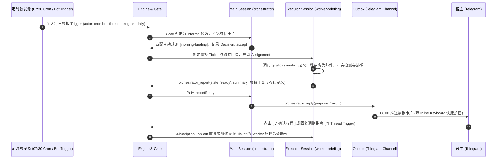

# 产品需求文档 (PRD)：个人全天候智能伴侣 (Personal Super-Agent)

**项目代号**：Project Aura  
**版本**：v1.1.0（对齐 `dsh-superagent` 领域模型与运行架构）  
**定位**：融合 **Today.ai** 的生活/工作伴侣体验与 **DeepSeek Super-agent (`dsh-superagent`)** 的“脑手分离、注意力克制”架构，部署于云端 VPS、以 Telegram 为交互中枢、以 Web Panel 为管理后台的个人专属自主智能体系统。

---

## 1. 产品愿景与设计哲学

### 1.1 核心痛点
当前市面上的 AI 助理（如传统网页版 Chatbot 或单会话 Agent）在作为个人长期助手时存在三大结构性缺陷：
1. **会话阻塞（Session Blocking）**：下发耗时 10 分钟的长任务（如深度行业研报、全量邮件归档）时，当前对话通道被阻塞，无法同时进行其他即时问答或任务派发。
2. **记忆中毒（Context Pollution）**：把两周前的闲聊、今天的日历、刚才的临时报错全混在同一 Context 中，导致推理质量下降、Token 成本失控与幻觉频发。
3. **注意力黑洞（Attention Sink）**：问一步动一下，频繁向用户推送无意义的中间过程日志（如“正在搜索网页 1/10…”），人类反而沦为 Agent 的“人肉监护人”。

### 1.2 核心哲学
严格遵循仓库 [`000-philosophy.md`](../000-philosophy.md) 与 Today.ai 的伴侣理念，确立 Aura 的三大核心支柱：
* **注意力预算第一（Attention-Economic First）**：*“Take as little human attention as possible, and give as much value as possible.”* 默认静默，只在**交付可用成果（`ready`）**、**必须人类拍板（`attention` / `human_action`）**或**确认为无法独自完成（`blocked` / `failed`）**时才发消息。
* **职责与会话彻底分离（Main Session Routing + Worker Session Execution）**：
  * **主 Session（`orchestrator`）**：仅负责候选评估（`Eval`）、路由分派（`orchestrator_route`）与最终结果/问题的转交（`orchestrator_reply`），绝不执行耗时 I/O 或具体业务工具，保证前台永不阻塞。
  * **执行器 Session（`worker-<ticketId>`）**：每个工单（`Ticket`）拥有独立的 DeepSeek Harness Session 与独立工作目录（`<stateDir>/work/<shortName>`），超 5 秒命令自动转入后台 Job，对人保持静默。
* **共生记忆与渐进式主动服务（Living Memory & Observe-then-Auto）**：利用版本化团队提示词（Team Sections / Skills）与工单状态机沉淀长期记忆；主动任务（如晨报、邮件巡检）支持先以 `observe`（仅记录不打扰）模式试运行，验证准确后再切换为 `auto` 自动执行。

---

## 2. 系统整体架构（对齐 `001-domain` 与 `007-architecture`）

```mermaid
flowchart TD
    subgraph Client["交互与管理终端 (Client Layer)"]
        TG["Telegram (Mobile & Desktop)<br>· 私聊/Topic 交互 · 内联审批按钮 · 原地回执更新"]
        Panel["Superagent Web Panel (127.0.0.1)<br>· 待人工处理概览 · Policy/Prompt 版本配置 · 健康监控"]
    end

    subgraph HostLayer["dsh-superagent 核心域与协调层 (Engine + Main Session)"]
        TG_Source["Telegram SourceKind (tg-cli)<br>· 轮询消息与按钮回调 · Scope 过滤"]
        Engine["Domain Engine (SQLite Store)<br>· Intake 扇出 · Gate 准入 · Ticket/Mandate 状态机"]
        Assessor["Main Session (orchestrator)<br>· orchestrator_route 路由 · Proactive Eval 研判"]
        Outbox["Outbox & Effects 持久化队列<br>· 保序发送 · 指数退避重试 · 幂等投递"]

        TG_Source -->|Trigger| Engine
        Engine -->|Candidate| Assessor
        Assessor -->|Decision: accept / attach / stop / ignore| Engine
        Engine -->|OutboundMessage| Outbox
        Outbox -->|sendTelegram| TG_Source
    end

    subgraph WorkerCluster["DshExecutor 执行层 (Per-Ticket Session & Directory)"]
        W_Brief["Ticket Worker: 每日晨报<br>· work/daily-briefing-*"]
        W_Research["Ticket Worker: 深度调研<br>· work/research-* (5s 后台 Job + Subagent)"]
        W_Inbox["Ticket Worker: 邮件与日程管家<br>· work/inbox-*"]
    end

    subgraph Integrations["外部能力与记忆资产 (CLI Shims + Skills + Knowledge)"]
        CLIs["受控 CLI 工具集 (worker-bin)<br>· gcal-cli · mail-cli · tavily-cli"]
        Memory["三层共生记忆<br>· L1: Prompts/Skills · L2: Store Tickets/KV · L3: knowledge/"]
    end

    TG <===> TG_Source
    Panel <===> Engine
    Engine -->|Assignment Launch / Input Delivery| WorkerCluster
    WorkerCluster -->|orchestrator_report (progress/ready/waiting/blocked)| Engine
    WorkerCluster <===> CLIs
    WorkerCluster <===> Memory
```

---

## 3. 核心功能规格 (Functional Specifications)

### 3.1 接入与交互模块 (Telegram `SourceKind`)

#### 规格要求
* **通信模式**：通过 `dsh-superagent-telegram` 插件与受控 CLI（`tg-cli`）以长轮询（Long Polling `getUpdates`）方式拉取消息与 `callback_query` 按钮事件，部署在海外 VPS 上，无需暴露公网 Webhook 端口。
* **两层准入控制（Scope + Gate）**：
  * **Scope 层**：校验会话是否在监听范围（如开启私聊 `directMessages: true` 或指定群组/Topic）。
  * **Gate 层（物理级白名单）**：在 `Policy.sources.telegram.allowed` 中配置宿主本人的 Telegram User ID。非白名单用户的消息在确定性 Gate 层直接拦截（`not_allowed`），**不唤醒主 Session，零 LLM Token 消耗**。
* **交互与路由契约（遵循 [`002-authorization.md`](../002-authorization.md) 与 [`004-prompts.md`](../004-prompts.md)）**：
  * **新请求（Explicit Request）**：宿主发送新指令 → Gate 判定为 `explicit` → 主 Session 通过 `orchestrator_route(accept)` 立即创建 `Ticket` 并由 `Outbox` 发送单句确认回执（`acknowledgement`，说出具体目标与预期产出），随即释放主会话。
  * **多轮追问直达（Subscription Fan-out）**：宿主在已有 `Ticket` 的 Telegram 线程（或针对该工单消息回复/点击按钮）继续说话时，`Intake` 通过**订阅扇出（Fan-out）**将消息作为 `Input` **直接投递给该工单的 `Executor Session`**（若工单已结束且非人工停止，则自动携原 `Mandate` 唤醒恢复），无需再次经过 `Eval` 评估。
  * **静默克制与原地更新**：Worker 执行期间保持静默（`progress` 报告仅保存在内部，不发 IM 消息）；若渠道支持原地状态更新，可在原回执消息上调用 `editMessageText` 更新状态，严禁连发过程消息刷屏。

---

### 3.2 晨间主动简报系统 (Morning Briefing Engine)

#### 业务时序流程
遵循 [`001-domain.md`](../001-domain.md) *“等待与定时条件属于普通 Source，而非 Eval”* 的原则，定时晨报不绕过领域模型，而是作为一条标准的主动候选（Inferred Candidate）流转：



#### 晨报卡片内容规范
* **今日日程视图**：按时间轴陈列，高亮冲突会议。
* **待办核心三件事**：结合未完结 `Tickets` 与个人画像，挑选最具杠杆率的 Top 3 任务。
* **重要信息雷达**：不超过 2 条需关注的关键邮件或外部动态。
* **底部操作按钮（Inline Keyboard）**：
  * `[ ✓ 确认行程 ]`（回调数据：`ticket:<id>:confirm_schedule`）
  * `[ 📝 补充待办 ]`（回调数据：`ticket:<id>:add_todo`）
  * `[ 🔕 今日免打扰 ]`（回调数据：`ticket:<id>:dnd_today`）

---

### 3.3 异步沙箱长任务系统 (DshExecutor & Worker Sessions)

直接复用 `dsh-superagent` 的 [`DshExecutor`](../003-execution.md) 执行器体系：

#### Worker 规格
* **环境与目录隔离**：每个 `Ticket` 拥有独立的 `worker-<ticketId>` 会话和 `<stateDir>/work/<shortName>` 目录，通过 `prepare` 脚本初始化工作区（如挂载本地知识库软链或 Git worktree）。
* **5 秒自动后台化与并发槽位（`WorkerSlots`）**：
  * Worker 运行在 `dsh-superagent-worker` Preset 下，任何前台 Shell 命令执行超过 **5 秒**自动转入后台 Job，使 Worker 在等待爬虫或长脚本时仍能随时响应宿主的追问或停止指令（`stop`）。
  * 当后台 Job 或 Subagent 仍在运行时，工单保持占用槽位并在完成后自动唤醒 Worker；当交接给人类审批（`ready` 或 `attention`）时，**立即释放槽位**（[`003-execution.md`](../003-execution.md#L37-L39)），绝不阻塞其他任务。
  * 系统预留 **1 个专属优先槽位** 给人类消息唤醒（[`003-execution.md`](../003-execution.md#L58-L60)），确保即便后台满负荷跑长任务，宿主发话也能立即得到响应。
* **典型场景支持**：
  1. **深度网络调研（Research Ticket）**：利用内置 `@deepseek-ai/dsh-tool-web`、`tavily-cli` 与 `standard` 子智能体并行检索多源资料，交叉验证后将长文研报写入 `<stateDir>/knowledge/reports/`，并在 Telegram 返回精炼结论与归档路径。
  2. **数字文件与邮件管家（Inbox Ticket）**：通过 `mail-cli` 扫描未读邮件，提取账单/附件归档，生成拟回复草稿并通过 `human_action` 提交宿主一键审批。

---

### 3.4 共生记忆架构 (Living Memory Architecture)

为避免另起炉灶维护两套状态机，三层记忆深度映射到 `dsh-superagent` 原生基础设施：

| 记忆层级 | 原生存储载体 | 读写与生命周期策略 | 内容示例 |
| :--- | :--- | :--- | :--- |
| **L1: 核心画像 (Profile)** | **Team Prompt Sections & Skills**<br>（[`Prompts`](../004-prompts.md) 版本化存储于 SQLite） | 低频更新；每次模型请求自动组装注入；支持通过面板或对话指令（`orchestrator_prompts_save`）升级并保留历史版本 | 核心工作作息、沟通精炼度要求、家庭/同事代称映射、固定偏好 |
| **L2: 当前状态 (Active State)** | **`Store` (`orchestrator.sqlite`)**<br>（活跃 `Tickets`、`Threads`、`Mandates` 与 `KV`） | 随工单流转实时事务更新；搁置/跟进中的事项天然体现为 `idle` 或 `person / answer` 状态的工单 | 当前进行中的长线任务、等待宿主拍板的 `Attention` 问题、近期跟进上下文 |
| **L3: 历史资产 (Cold Archive)** | **本地知识库 (`<stateDir>/knowledge/`)**<br>（Markdown 归档库 / Git 仓库） | Worker 按需通过 `tool-fs-search` / `rg` 检索，不常驻日常 Prompt；工单完成时将长文产物沉淀入库 | 往期深度研报全文、历史会议纪要、长期项目资料归档 |

---

### 3.5 权限分级与审批契约 (Attention & Permission Protocol)

结合 [`002-authorization.md`](../002-authorization.md)、[`003-execution.md`](../003-execution.md) 与 [`004-prompts.md`](../004-prompts.md)，将权限控制落实到**执行阶段汇报**与**底层命令 Shim 硬隔离**：

```
+-----------------------------------------------------------------------+
| L1 级：只读与沙箱内计算 (Worker 自动执行，过程静默)                     |
| 范围：网页检索、知识库阅读、日程/邮件只读查询、Ticket 目录内文件读写   |
| 机制：Worker 直接调用只读命令，内部记录 progress，不发外部消息          |
+-----------------------------------------------------------------------+
                                  │
+-----------------------------------------------------------------------+
| L2 级：低风险/可逆草稿操作 (先创建草稿，在 Result 中汇报并提供撤销)     |
| 范围：在邮箱创建 Draft 草稿、写入待确认日程草稿、新增知识库笔记        |
| 机制：Worker 完成草稿后报告 ready，Outbox 推送结果卡片及可逆操作按钮    |
+-----------------------------------------------------------------------+
                                  │
+-----------------------------------------------------------------------+
| L3 级：对外发送/不可逆写操作 (执行期强拦截，必须人类 Attention 审批)    |
| 范围：正式对外发送邮件、删除重要日程/文件、触发外部写接口              |
| 机制：                                                                |
|   1. 软硬双控：worker-bin 下的 CLI Shim 拒绝无审批凭据的高危子命令；   |
|   2. 结构化提问：Worker 调用 orchestrator_report(human_action: ...)； |
|   3. 内联卡片：Main Session 调用 orchestrator_reply(purpose: attention)|
|      在 Telegram 弹出带 [ ✓ 确认执行 ] / [ ✕ 放弃 ] 的审批卡片；       |
|   4. 唤醒放行：宿主点击按钮后作为同 Thread Trigger 唤醒 Worker 完成操作|
+-----------------------------------------------------------------------+
```

---

### 4. 非功能性需求与运行环境 (NFR)

#### 4.1 部署架构与依赖（对齐 [`006-deployment.md`](../006-deployment.md)）
* **运行节点**：海外 VPS（推荐美西 Ubuntu 22.04+ LTS，2 核 4G 内存）。
* **核心运行底座**：
  * Node.js `^22.19.0 || >=24.0.0`、`pnpm`、`git` 2.32+、`python3` 3.8+、`tmux`。
  * **DeepSeek Harness (`@deepseek-ai/dsh`)**：以独立 Profile（`superagent`）运行本插件 Bundle。
  * **受控 CLI 封装（`~/.local/bin/`）**：`tg-bot`（Telegram 机器人 CLI）、`gcal-agent`（日历 CLI）、`mail-agent`（邮件 CLI）。
* **进程管理与自愈**：
  * 使用仓库自带的 `scripts/dsh-superagent start|stop|restart|status` 脚本在 `tmux` 会话中托管服务；
  * 配置每小时自愈巡检（Hourly Check，根据 `status` 退出码 `0/1/2/3` 自动恢复异常或上报配置错误）。

#### 4.2 安全与稳定性
* **网络安全**：Web Panel 仅绑定 `127.0.0.1:<port>`（通过 SSH 隧道访问），Telegram 采用出站长轮询，VPS 仅需开放 SSH 端口（公钥认证）。
* **多级超时与防死循环保护**：
  * `Eval` 评估超时自动重试，连续 3 次超时标记为 `unavailable` 并在面板告警；
  * Worker 前台命令 5 秒自动转后台 Job，后台工作单轮最长 30 分钟超时清理（[`003-execution.md`](../003-execution.md#L35-L36)）；
  * `Effects` 与 `Outbox` 具备 SQLite 持久化与指数退避重试（`2s → 60s` / `5s → 300s`），进程重启后自动恢复中断的 `Assignment` 且不重发已读消息。

---

## 5. 项目分阶段实施路线图 (Roadmap)

### Phase 1: Telegram `SourceKind` 接入与核心闭环（已完成）
- [x] 编写 `tg-cli` CLI 脚本与 `src/sources/telegram*.ts` 插件（遵循 [`008-cookbook.md`](../008-cookbook.md) 规范，支持可选解耦 GitHub 仓库）。
- [x] 完成 `KV.telegram` 游标注册、`tsdown.config.ts` / `package.json` / `cordis.patch.yml` 导出配置，并通过 `tests/telegram.spec.ts` 与 `tests/docs.spec.ts` 全量测试。
- [x] 部署 `superagent` Profile，打通 Telegram 白名单准入、单句 `acknowledgement` 回执、Worker 执行与 `result` 交付闭环。

### Phase 2: 个人工具链（CLI + Skills）与 L3 审批闭环（已完成）
- [x] 封装 `gcal-cli`、`mail-cli` 与 `tavily-cli`（位于 `scripts/aura-cli/`），实现 L1/L2/L3 权限分级与 `--approved-by` 硬校验。
- [x] 编写 `skills/dsh-superagent-telegram/SKILL.md` 及个人工具 Skill，配置 Team Prompt Sections 注入宿主画像（L1 Memory）。
- [x] 验证 `human_action` → `purpose: 'attention'` → Telegram Inline Keyboard 点击回调 → 唤醒 Worker 放行 L3 操作的完整链路。

### Phase 3: 主动晨报（Proactive Rule）与长期知识库演进（已完成）
- [x] 编写 `aura-cron` 定时触发器并配置 `morning-briefing` / `memory-digest` 主动规则，打通每日晨报卡片与快捷内联按钮推送。
- [x] 编写 `aura-kb` 知识库 CLI，配置 `<stateDir>/knowledge/` 本地知识库与 `prepare` 脚本，跑通深度调研长文沉淀、索引更新与历史检索（L3 Memory）。
